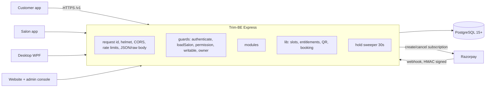

# Architecture

## Components



`src/app.ts` builds the app; every module registers routes through `Api` (`src/http/api.ts`), which records method, path, auth kind, permission, zod body/query schemas. That registry drives both the guards and the generated `openapi.yaml` (a test asserts registry and file agree).

## Request flow: booking

```mermaid
sequenceDiagram
  participant C as Customer app
  participant A as API
  participant DB as Postgres
  participant S as Salon app
  C->>A: GET /salons/:id/availability
  A->>DB: hours, closures, time off, active bookings
  A-->>C: slots (15 min grid, salon timezone)
  C->>A: POST /bookings/hold (Idempotency-Key)
  A->>DB: sweep expired holds; INSERT held booking
  DB-->>A: 23P01 exclusion violation => SLOT_TAKEN
  A-->>C: held, holdExpiresAt (5 min)
  C->>A: POST /bookings/:id/confirm
  A->>DB: UPDATE ... WHERE status='held' AND hold_expires_at>now()
  A-->>C: confirmed + qrToken
  S->>A: POST /salons/:id/checkin {qrToken}
  A->>DB: UPDATE ... WHERE status='confirmed' AND qr_nonce=$ AND in window
  A-->>S: checked_in (second scan: ALREADY_CHECKED_IN)
  S->>A: POST /salons/:id/invoices {bookingId,...}
  A->>DB: counter++ , invoice, items, payments, booking=completed (one tx)
```

## Request flow: subscription

```mermaid
sequenceDiagram
  participant W as Website portal
  participant A as API
  participant R as Razorpay
  W->>A: POST /salons/:id/subscription/checkout
  A->>R: subscriptions.create (notes app=trim, salonId)
  A-->>W: razorpaySubscriptionId, keyId
  W->>R: Razorpay Checkout (checkout.js)
  R->>A: POST /webhooks/razorpay (X-Razorpay-Signature)
  A->>A: verify HMAC over raw body; INSERT subscription_events (unique event id)
  A->>A: apply event if not stale (created_at vs last_event_at); receipt on charged
  W->>A: GET /salons/:id/subscription (poll)
```

## Concurrency design (spec section 7)

| Rule | Mechanism |
|---|---|
| No double booking | `EXCLUDE USING gist (staff_id WITH =, during WITH &&) WHERE status IN ('held','confirmed','checked_in')`. The API only translates `23P01` (and `40P01`, which Postgres can raise between concurrent exclusion checks) into `SLOT_TAKEN`. Expired holds are flipped to `expired` lazily inside hold/availability and by the sweeper (`FOR UPDATE SKIP LOCKED`) |
| Idempotency | `idempotency_keys(scope,key,endpoint)` with a request hash: insert-first, run, store response; same key + different body is 422; in-flight duplicates wait for the first result |
| Check-in | single conditional `UPDATE ... RETURNING` including nonce and time window; the loser reads the state and reports `ALREADY_CHECKED_IN` / `QR_OUTDATED` / `OUT_OF_WINDOW` |
| Invoice numbers | `UPDATE invoice_counters SET last_no=last_no+1 RETURNING` inside the invoice transaction; the row lock serialises, rollback releases the number |
| Reschedule | `bookings.version` compare-and-set; nonce rotates so old QR codes die |
| Webhook replay | `subscription_events.razorpay_event_id` unique, `INSERT ... ON CONFLICT DO NOTHING` in the same transaction as the state change; stale events compared by event `created_at` |
| Plan limits | `SELECT ... FROM salons FOR UPDATE` then count, inside one transaction (`lib/salonLock.ts`) |

## Security model

- Passwords: argon2id; unknown users still pay a hash to keep timing flat. 5 failures lock the account 15 min (429 `RATE_LIMITED`); login limiter per IP+identifier; general limiter per IP.
- Access JWT (HS256, 15 min) carries `sub, role, sid`. Every request also checks the session row and `users.is_active`, so logout, deactivation and password change take effect immediately.
- Refresh tokens: 256-bit random, only the SHA-256 is stored, rotated on every use; presenting a rotated token revokes the whole family.
- RBAC is server-side on every salon route: membership + permission set loaded per request (`loadSalon`), `requirePerm`, `requireWritable` (read-only when the subscription lapsed), `ownerOnly`. Admin gets all permissions on any salon (support), but is not "owner".
- Input: zod strict objects (unknown fields rejected), trimmed strings, DB CHECK constraints as backstop. Images: size cap, base64 charset check, magic bytes must agree with the declared mime, base64 column never selected in lists.
- Webhook: raw body, HMAC-SHA256, timing-safe compare. Events whose notes lack `app:"trim"` are ignored (shared Razorpay account).
- Secrets only from env; pino redacts auth headers and token fields; CSV export neutralises formula injection. helmet, CORS allow-list, request ids on every response.

## Decisions (interpretations of the spec)

1. **Error codes.** `error.code` is the specific code (`SLOT_TAKEN`, `HOLD_EXPIRED`, `ALREADY_CHECKED_IN`, `VERSION_MISMATCH`, `OUT_OF_WINDOW`) with HTTP 409. Generic conflicts use `CONFLICT` plus `error.reason` (`LAST_OWNER`, `CANCEL_CUTOFF`, `QR_OUTDATED`, `INVALID_STATE`, `REVIEW_EXISTS`, `ALREADY_SUBSCRIBED`, ...). `PLAN_LIMIT` is HTTP 403 with `details: {limit, max?, current?}` (object, not the usual array). Wrong-salon QR is 403 `FORBIDDEN` reason `WRONG_SALON`; a locked account is 429 `RATE_LIMITED`.
2. **Auth responses.** `/auth/register` and `/auth/register-owner` return the same shape as login (tokens, user, memberships; owner adds `salon`). Memberships carry extra fields (`staffId`, `salonStatus`, `planCode`, `readOnly`). Login identifier accepts e-mail, E.164 or a 10-digit Indian number; register requires strict E.164.
3. **Hold/confirm.** Hold is customer-role only, `startsAt` on a 5-minute boundary, not in the past, <= 60 days ahead, inside working hours and not in time off (422 / `SLOT_TAKEN`). Confirm is idempotent for an already-confirmed booking. Duration = sum of services (each `ceil(duration x speed)` to 5 min) + sum of buffers; the booking occupies that whole time.
4. **Availability** is public (no token), 15-minute absolute grid in the salon timezone, never in the past. Staff hours override salon hours per weekday (a weekday without a row falls back to salon hours; use time off to block days). A staff member with no `staff_services` rows performs all services.
5. **Plans.** `max_staff` counts all active staff including the owner. `max_branches` is stored and exposed but not enforced (there is no multi-branch endpoint in section 6). Trial = Pro level for 14 days; expired trial = read-only. `past_due` keeps access for 7 days from `past_due_since`. Suspended salons are read-only and hidden. `billFooter`/`brandColor` need `bill_templates`. Role editing on Starter: system roles cannot be edited, the `owner` role is never editable.
6. **Read-only mode** blocks walk-ins, reschedules, invoices, service/role/staff creation. Allowed: reads, check-in, complete, cancel, no-show, exports, settings, subscription actions.
7. **Subscription.** Checkout is refused (`ALREADY_SUBSCRIBED`) while an uncancelled `active` subscription exists; plan changes mid-term are not implemented in v1 (cancel at period end, then subscribe). The first charge is delayed with `start_at` to the end of a running trial. Changing a plan price via the admin API clears the stored Razorpay plan id so the script can recreate it. Event id comes from `X-Razorpay-Event-Id` (fallback: SHA-256 of the body).
8. **Billing.** Payments must sum to the total and are mandatory when total > 0 (the `draft` status exists but is unused). One non-void invoice per booking. Subtotal cap Rs 10,00,000. Invoice number `PREFIX-YYYY-NNNNNN` where the counter is per salon and never resets per year. Tax only when `gst_enabled` + GSTIN.
9. **Payment methods.** GET is readable by any salon member (billers need it); PUT needs `payments.configure`.
10. **Reviews.** Reply body is `{replyText}`, report body `{reason}`. A reported review stays public until an admin hides it (`PATCH /admin/reviews/:id`); the aggregate counts visible + reported.
11. **CRM.** Customers are derived by phone (or lower-cased name for phone-less walk-ins); the list `id` is the key to use in the detail URL (URL-encode it).
12. **Dates** in analytics/exports are salon-local calendar dates, default last 30 days, max 366. CSV exports invoices.
13. **No-show** is only allowed once the start time has passed; walk-ins may start up to 30 minutes in the past.
14. **Extra routes beyond section 6:** `GET /invites/:code`, `DELETE /media/:id`, `GET/POST/DELETE /salons/:id/closures`, `GET /admin/plans`, `POST /admin/sales-agents`, `PATCH /admin/users/:id`, `PATCH /admin/reviews/:id`, `GET /salons/:id/bookings/:bookingId`, `GET /salons/:id/customers/:key`, staff time-off/hours routes, `GET /discover/...` helpers, `?templateId=` filter on discover (for "book this style").
15. **Pagination** is keyset (`created_at`/`starts_at` + id, microsecond-safe via text cursors); discover uses an opaque offset cursor because of distance/rating ordering.
16. **Test database** is PostgreSQL 18 (embedded-postgres); production targets 15+ and uses nothing newer.
