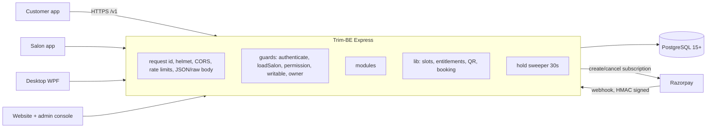
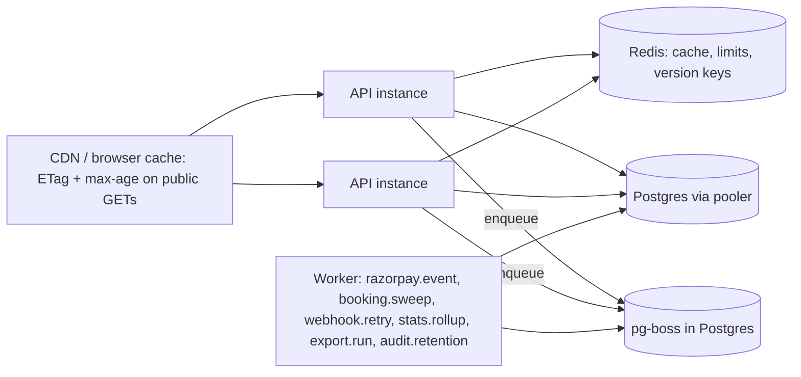

# Architecture

## Components



`src/app.ts` builds the app; every module registers routes through `Api` (`src/http/api.ts`), which records method, path, auth kind, permission, zod body/query schemas. That registry drives both the guards and the generated `openapi.yaml` (a test asserts registry and file agree).

## Request flow: booking

```mermaid
sequenceDiagram
  participant C as Customer app
  participant A as API
  participant DB as Postgres
  participant S as Salon app
  C->>A: GET /salons/:id/availability
  A->>DB: hours, closures, time off, active bookings
  A-->>C: slots (15 min grid, salon timezone)
  C->>A: POST /bookings/hold (Idempotency-Key)
  A->>DB: sweep expired holds; INSERT held booking
  DB-->>A: 23P01 exclusion violation => SLOT_TAKEN
  A-->>C: held, holdExpiresAt (5 min)
  C->>A: POST /bookings/:id/confirm
  A->>DB: UPDATE ... WHERE status='held' AND hold_expires_at>now()
  A-->>C: confirmed + qrToken
  S->>A: POST /salons/:id/checkin {qrToken}
  A->>DB: UPDATE ... WHERE status='confirmed' AND qr_nonce=$ AND in window
  A-->>S: checked_in (second scan: ALREADY_CHECKED_IN)
  S->>A: POST /salons/:id/invoices {bookingId,...}
  A->>DB: counter++ , invoice, items, payments, booking=completed (one tx)
```

## Request flow: subscription

```mermaid
sequenceDiagram
  participant W as Website portal
  participant A as API
  participant R as Razorpay
  W->>A: POST /salons/:id/subscription/checkout
  A->>R: subscriptions.create (notes app=trim, salonId)
  A-->>W: razorpaySubscriptionId, keyId
  W->>R: Razorpay Checkout (checkout.js)
  R->>A: POST /webhooks/razorpay (X-Razorpay-Signature)
  A->>A: verify HMAC over raw body; INSERT subscription_events (unique event id)
  A->>A: apply event if not stale (created_at vs last_event_at); receipt on charged
  W->>A: GET /salons/:id/subscription (poll)
```

## Concurrency design (spec section 7)

| Rule | Mechanism |
|---|---|
| No double booking | `EXCLUDE USING gist (staff_id WITH =, during WITH &&) WHERE status IN ('held','confirmed','checked_in')`. The API only translates `23P01` (and `40P01`, which Postgres can raise between concurrent exclusion checks) into `SLOT_TAKEN`. Expired holds are flipped to `expired` lazily inside hold/availability and by the sweeper (`FOR UPDATE SKIP LOCKED`) |
| Idempotency | `idempotency_keys(scope,key,endpoint)` with a request hash: insert-first, run, store response; same key + different body is 422; in-flight duplicates wait for the first result |
| Check-in | single conditional `UPDATE ... RETURNING` including nonce and time window; the loser reads the state and reports `ALREADY_CHECKED_IN` / `QR_OUTDATED` / `OUT_OF_WINDOW` |
| Invoice numbers | `UPDATE invoice_counters SET last_no=last_no+1 RETURNING` inside the invoice transaction; the row lock serialises, rollback releases the number |
| Reschedule | `bookings.version` compare-and-set; nonce rotates so old QR codes die |
| Webhook replay | `subscription_events.razorpay_event_id` unique, `INSERT ... ON CONFLICT DO NOTHING` in the same transaction as the state change; stale events compared by event `created_at` |
| Plan limits | `SELECT ... FROM salons FOR UPDATE` then count, inside one transaction (`lib/salonLock.ts`) |

## Security model

- Passwords: argon2id; unknown users still pay a hash to keep timing flat. 5 failures lock the account 15 min (429 `RATE_LIMITED`); login limiter per IP+identifier; general limiter per IP.
- Access JWT (HS256, 15 min) carries `sub, role, sid`. Every request also checks the session row and `users.is_active`, so logout, deactivation and password change take effect immediately.
- Refresh tokens: 256-bit random, only the SHA-256 is stored, rotated on every use; presenting a rotated token revokes the whole family.
- RBAC is server-side on every salon route: membership + permission set loaded per request (`loadSalon`), `requirePerm`, `requireWritable` (read-only when the subscription lapsed), `ownerOnly`. Admin gets all permissions on any salon (support), but is not "owner".
- Input: zod strict objects (unknown fields rejected), trimmed strings, DB CHECK constraints as backstop. Images: size cap, base64 charset check, magic bytes must agree with the declared mime, base64 column never selected in lists.
- Webhook: raw body, HMAC-SHA256, timing-safe compare. Events whose notes lack `app:"trim"` are ignored (shared Razorpay account).
- Secrets only from env; pino redacts auth headers and token fields; CSV export neutralises formula injection. helmet, CORS allow-list, request ids on every response.

## Scale design (spec section 11)

Principle: **correctness never depends on cache, Redis or the queue.** The database constraints (booking exclusion constraint, unique idempotency / webhook / invoice keys, counters) are the only authority; everything below is an optimisation or protection layer that can fail without affecting correctness.

### Stages (same code, chosen by environment)

| Stage | Load (planning numbers, unconfirmed) | Shape | Settings |
|---|---|---|---|
| A | up to ~10k req/day | 1 API instance, `WORKER_MODE=both`, in-memory cache + limiter, pg-boss queue | defaults |
| B | ~100k req/day | 2+ API instances + 1 worker, managed Redis, Supabase Pro + transaction pooler, CDN on public GETs | `CACHE_DRIVER=redis`, `RATE_LIMIT_DRIVER=redis`, `REDIS_URL`, `DB_POOLER=true`, `DB_POOL_MAX` = pooler limit / instances, `QUEUE_DATABASE_URL` (direct), API `WORKER_MODE=api`, worker `WORKER_MODE=worker` |
| C | ~1M req/day | autoscaled API, separate worker, Redis, CDN, read replica for analytics/search, partitioned big tables | as B plus replica + partitions (not built) |

Honest limit: Stage B/C behaviour has **not** been load tested. The k6 scripts exist (`loadtest/`) but were not run, and the Redis drivers have only been tested against an in-memory fake (no live Redis). The memory cache does not propagate invalidation between instances, so more than one API instance requires `CACHE_DRIVER=redis` (or TTLs of a few seconds).



### Caching map (`src/infra/cache.ts`: Cache driver + CacheService)
CacheService = cache-aside with single-flight (one loader per key), +-10 % TTL jitter, stale-while-revalidate (entries live 3x their TTL), version keys, and "driver failure falls through to the DB". TTL 0 disables a cache (tests use that).

| What | Key | TTL (env) | Invalidation |
|---|---|---|---|
| plans | `plans` (+ in-process copy) | 1 h (`CACHE_TTL_PLANS_S`) | admin plan edit deletes it |
| service templates, hairstyles | `templates`, `hair:v<catalog>:...` | 24 h (`..._CATALOG_S`) | `catalog` version bumped by admin hairstyle CRUD |
| public salon profile | `pub:salon:<id>:v<salonVersion>` | 120 s | `salon:<id>` version bumped by ANY non-GET request with that salonId (profile, services, staff, roles, hours, closures, subscription), by booking/review changes and by the webhook worker |
| discovery search | `disc:v<discoverVersion>:<hash of filters + position snapped to ~110 m>` | 45 s | `discover` version bumped with every salon bump |
| availability answer | `avail:<salon>:v<salonVersion>:<date>:<services>:<staff>` | 8 s | salon version bump on any hold/confirm/cancel/walk-in/reschedule; the hold re-verifies in the DB anyway |
| session lookup | `sess:<sid>:<userVersion>` | 30 s | `user:<id>` version bumped on logout, logout-all, password change, refresh rotation/reuse, deactivation, account deletion |
| salon context (salon + subscription + membership/permissions) | `sctx:<salon>:<user>:v<salonVersion>` | 30 s | salon version bump (role/staff/subscription changes all pass through a salon-scoped route, webhook worker or admin action); entitlements are recomputed from the cached rows on every request so trial expiry is exact |

Invalidation happens in `Api` (`installBump`): the response is only released after the version keys were bumped, so a client never reads its own write from a stale cache. Authenticated and permission-dependent data is never shared between users (keys include the user id).
HTTP: public GETs send `ETag` (weak, body hash) + `Cache-Control: public, max-age, stale-while-revalidate` and answer `If-None-Match` with 304; media uses its SHA-256 ETag and a 1-day cache.

### Rate limiting and abuse protection (`src/infra/limiter.ts`, `src/http/rateLimit.ts`)
Sliding-window counter; memory driver, or Redis driver that **fails open**. Limits: general per IP, login per IP+identifier (plus account lockout), register per IP, contact per IP, availability per user/IP, hold per user, check-in per salon, async export per user; the Razorpay webhook is exempt (signature verified). 429 carries `Retry-After` and `RateLimit-Limit/Remaining/Reset`. Slot hoarding caps per customer (3 active holds, 10 upcoming confirmed, 5 created per 24 h) are checked inside the hold transaction under a per-customer advisory lock, so they are exact under parallel requests. Hard limits: body 100 KB (media 400 KB), request timeout 15 s, `statement_timeout` 5 s, `lock_timeout` 2 s, `idle_in_transaction_session_timeout` 10 s (via startup options, or `SET LOCAL` per transaction when `DB_POOLER=true`).

### Hot slot (`POST /bookings/hold`)
1. Availability is advisory. One atomic `INSERT` guarded by the exclusion constraint decides.
2. Latency-safe hold path (round 4, measured with 50 ms per DB round trip and a pool of 5): all reads and validation run first on short-lived pooled connections; losers of an identical staff+start are answered from an in-process single flight (no DB); a one-statement pre-check (which also expires that staff member's stale holds) rejects starts already inside an active booking; the transaction only takes the per-customer advisory lock (exact hoarding caps), counts caps and runs ONE statement that inserts the booking and its items. No pooled connection waits on a slot-wide lock, so a stampede no longer serialises on (queries x RTT). Pool-acquire, statement and lock timeouts map to 503 `OVERLOADED`, never 500. Alternatives for concurrent losers share one availability computation (1.5 s).
3. Losers get `409 SLOT_TAKEN` with `details.alternatives` (next <= 3 free starts for the same staff/services). Deadlock / serialization / lock-timeout errors retry the whole transaction up to 2 times with jitter, then 409 (or 503 for lock timeout).
4. Expired holds are ignored by availability (predicate) and swept lazily inside the hold transaction (`FOR UPDATE SKIP LOCKED`) and by the `booking.sweep` job.
5. Optional Redis fast-fail (`SET NX` on staff+start, 5 s) rejects obvious duplicates before the DB; only active with `CACHE_DRIVER=redis`, released when the hold fails, never trusted for correctness.

### Queue and workers (`src/infra/queue.ts`, `src/jobs`)
`JobQueue` has three implementations: **pg-boss** (Postgres, durable, retries with backoff; default), in-memory (tests/dev) and inline (`QUEUE_ENABLED=false`: handlers run inside the request). `WORKER_MODE=api|worker|both`: API-only processes only enqueue; a worker-only process exposes just `/health` and `/ready`. Jobs are idempotent.

| Job | Trigger | What |
|---|---|---|
| `razorpay.event` | webhook request | apply a stored event once (row lock + `processed_at`), then invalidate the salon cache. The endpoint itself only verifies the signature, stores the event (unique id) and returns 200 |
| `webhook.retry` | every 60 s | re-enqueue events stored > 30 s ago and still unprocessed (lost job, worker crash, queue down) |
| `booking.sweep` | every 30 s | expire holds |
| `stats.rollup` | hourly | rebuild `daily_salon_stats` for the last 3 days (day / staff / service rows) |
| `audit.retention` | daily | drop audit rows > 400 days, idempotency keys > 48 h, export jobs > 14 days |
| `export.run` | export request | build an invoice CSV for ranges > 92 days or `POST .../analytics/export` (202 + job id) |

Recurring jobs are triggered by an interval in each consuming process and de-duplicated by singleton keys. Notifications and contact-message e-mail are not implemented (no sender configured).

### Client IP behind the website
The API trusts `TRUST_PROXY` hops for direct clients. The website BFF authenticates itself with `X-Trim-BFF-Key` (shared secret) and passes the visitor's address in `X-Trim-Client-IP`; `src/http/clientIp.ts` then overrides `req.ip` for rate limiting, audit and logs. Wrong or missing key => both headers ignored.

### Input hygiene
`src/http/sanitize.ts` rejects NUL characters in URL, query, path params and every string in JSON bodies with 422 before any handler runs (Postgres text cannot store them). Wrong-method requests on a known path answer 405 with `Allow`. Provider failures map to 502 `UPSTREAM_ERROR`. The webhook worker polls every 0.5 s in batches of 10 with 2 local workers (20 events drain in well under 10 s).

### Active users
The auth middleware calls `recordActivity` (src/lib/activity.ts) on every authenticated request: an in-process set (userId:IST-day, cleared at the day change) lets at most one `INSERT ... ON CONFLICT DO NOTHING` per user per day through, and it is not awaited (errors are logged at debug).
`GET /admin/stats` computes DAU (asOf), WAU (7 IST days incl. asOf), MAU (30) and a gap-filled 30-day series from `user_activity_days` (indexed by day; 400-day retention).

### Founding-salon waitlist and e-mail
`src/modules/waitlist.ts`: public `GET /waitlist/status` and `POST /waitlist` (per-IP limiter `waitlist`, BFF-aware; honeypot; `WAITLIST_OPEN` gate) and admin list/CSV. The insert is `INSERT ... ON CONFLICT (email) DO NOTHING RETURNING` on a citext-unique column, so concurrent duplicates are safe; only a NEW row enqueues the job `waitlist.notify` (singleton key = row id; an enqueue failure is logged, never returned to the caller). The job (`processWaitlistNotify`) sends the applicant confirmation and the copy to `WAITLIST_NOTIFY_TO` independently, marks each with `confirmation_sent_at` / `owner_copy_sent_at`, and throws if either failed so the queue retries only what is unsent (at-least-once: a crash between SMTP accept and the UPDATE can duplicate one message).
`src/lib/mailer.ts` wraps nodemailer (SMTP, STARTTLS required on 587, file/URL access disabled, short timeouts); without `SMTP_HOST/USER/PASS` + `MAIL_FROM` it is a disabled no-op and logs one warning with key names only. Templates in `src/lib/waitlistMail.ts`: the applicant e-mail contains no user-supplied text (a public form must not become a way to send arbitrary text to third parties); the owner copy HTML-escapes every field and the subject goes through `headerSafe` (CR/LF stripped); names with control characters are rejected at validation. No images or tracking pixels. Metrics `mail_sent_total` / `mail_failed_total` by kind.
`waitlist_signups` is TEMPORARY: after launch, founding entitlements are copied onto salons (`matched_salon_id`) and only then may the table be dropped. Phase 2 (not built): founding trial at registration (Starter, 60 days from first login), Razorpay changes, trial-end reminders.

### Resilience and observability
Graceful shutdown (stop accepting, drain queue, close pools), `/health` liveness, `/ready` (DB gates readiness; queue and cache are reported but degrade gracefully), `/metrics` (token required in production: Bearer or X-Metrics-Token; Prometheus text: request counts + latency histogram by route, 429s, `SLOT_TAKEN`, cache hit/miss, load shed, DB pool gauges, queue depth; optional bearer token), request ids, pino logs with redaction, Razorpay calls behind a timeout + circuit breaker (create is not retried, cancel is), load shedding (503 `OVERLOADED` + Retry-After for optional reads when event-loop lag, DB pool waiters or queue backlog exceed thresholds; bookings, check-in, invoices, auth and webhooks are never shed), `captureException` hook for Sentry-style error tracking (no-op by default). Documented alerts to set up: 5xx rate > 1 %, p95 > 500 ms, `db_pool_waiting` > 0 for 1 min, `queue_depth` growing, `unprocessedWebhookEvents` > 0 for 5 min, `load_shed_total` rising.

### Database for scale
New indexes in migration 0008 (`bookings(staff_id, starts_at)`, `bookings(salon_id, status, starts_at)`, geo btree, partial indexes on active rows and public reviews, `sessions` active, invoices by status). **Discovery uses a bounding-box prefilter on `salons(lat, lng)` plus the exact haversine check, not PostGIS** (PostGIS is not available on the embedded test Postgres; moving to `geography` + GiST is the Stage C option). `daily_salon_stats` rollups feed the analytics daily series; `audit_log`/`bookings` partitioning and a read replica are not built. Migration 0010 enables RLS on every table and revokes `anon`/`authenticated` (defence in depth on Supabase); the API connects as the table owner, which bypasses RLS.

### Load tests
`loadtest/` contains k6 scripts (browse mix, hot-slot stampede of 500 users, auth burst, webhook replay, 150 req/s day-in-the-life) and `npm run loadtest:check` for the post-run "zero overlapping active bookings" invariant. **They have not been run.** Results (with the stage they were measured on) belong in this section once someone runs them: _no measurements yet_.

## Decisions (interpretations of the spec)

1. **Error codes.** `error.code` is the specific code (`SLOT_TAKEN`, `HOLD_EXPIRED`, `ALREADY_CHECKED_IN`, `VERSION_MISMATCH`, `OUT_OF_WINDOW`) with HTTP 409. Generic conflicts use `CONFLICT` plus `error.reason` (`LAST_OWNER`, `CANCEL_CUTOFF`, `QR_OUTDATED`, `INVALID_STATE`, `REVIEW_EXISTS`, `ALREADY_SUBSCRIBED`, ...). `PLAN_LIMIT` is HTTP 403 with `details: {limit, max?, current?}` (object, not the usual array). Wrong-salon QR is 403 `FORBIDDEN` reason `WRONG_SALON`; a locked account is 429 `RATE_LIMITED`.
2. **Auth responses.** `/auth/register` and `/auth/register-owner` return the same shape as login (tokens, user, memberships; owner adds `salon`). Memberships carry extra fields (`staffId`, `salonStatus`, `planCode`, `readOnly`). Login identifier accepts e-mail, E.164 or a 10-digit Indian number; register requires strict E.164.
3. **Hold/confirm.** Hold is customer-role only, `startsAt` on a 5-minute boundary, not in the past, <= 60 days ahead, inside working hours and not in time off (422 / `SLOT_TAKEN`). Confirm is idempotent for an already-confirmed booking. Duration = sum of services (each `ceil(duration x speed)` to 5 min) + sum of buffers; the booking occupies that whole time.
4. **Availability** is public (no token), 15-minute absolute grid in the salon timezone, never in the past. Staff hours override salon hours per weekday (a weekday without a row falls back to salon hours; use time off to block days). A staff member with no `staff_services` rows performs all services.
5. **Plans.** `max_staff` counts all active staff including the owner. `max_branches` is stored and exposed but not enforced (there is no multi-branch endpoint in section 6). Trial = Pro level for 14 days; expired trial = read-only. `past_due` keeps access for 7 days from `past_due_since`. Suspended salons are read-only and hidden. `billFooter`/`brandColor` need `bill_templates`. Role editing on Starter: system roles cannot be edited, the `owner` role is never editable.
6. **Read-only mode** blocks walk-ins, reschedules, invoices, service/role/staff creation. Allowed: reads, check-in, complete, cancel, no-show, exports, settings, subscription actions.
7. **Subscription.** Checkout is refused (`ALREADY_SUBSCRIBED`) while an uncancelled `active` subscription exists; plan changes mid-term are not implemented in v1 (cancel at period end, then subscribe). The first charge is delayed with `start_at` to the end of a running trial. Changing a plan price via the admin API clears the stored Razorpay plan id so the script can recreate it. Event id comes from `X-Razorpay-Event-Id` (fallback: SHA-256 of the body).
8. **Billing.** Payments must sum to the total and are mandatory when total > 0 (the `draft` status exists but is unused). One non-void invoice per booking. Subtotal cap Rs 10,00,000. Invoice number `PREFIX-YYYY-NNNNNN` where the counter is per salon and never resets per year. Tax only when `gst_enabled` + GSTIN.
9. **Payment methods.** GET is readable by any salon member (billers need it); PUT needs `payments.configure`.
10. **Reviews.** Reply body is `{replyText}`, report body `{reason}`. A reported review stays public until an admin hides it (`PATCH /admin/reviews/:id`); the aggregate counts visible + reported.
11. **CRM.** Customers are derived by phone (or lower-cased name for phone-less walk-ins); the list `id` is the key to use in the detail URL (URL-encode it).
12. **Dates** in analytics/exports are salon-local calendar dates, default last 30 days, max 366. CSV exports invoices.
13. **No-show** is only allowed once the start time has passed; walk-ins may start up to 30 minutes in the past.
14. **Extra routes beyond section 6:** `GET /invites/:code`, `DELETE /media/:id`, `GET/POST/DELETE /salons/:id/closures`, `GET /admin/plans`, `POST /admin/sales-agents`, `PATCH /admin/users/:id`, `PATCH /admin/reviews/:id`, `GET /salons/:id/bookings/:bookingId`, `GET /salons/:id/customers/:key`, staff time-off/hours routes, `GET /discover/...` helpers, `?templateId=` filter on discover (for "book this style").
15. **Pagination** is keyset (`created_at`/`starts_at` + id, microsecond-safe via text cursors); discover uses an opaque offset cursor because of distance/rating ordering.
17. **Webhook is asynchronous.** `POST /webhooks/razorpay` answers `{received:true, result:"queued"|"duplicate"}` after storing the event; state changes happen a moment later in the worker. The outcome (`applied`, `stale`, `ignored`) is stored in `subscription_events.result`. Clients already poll the subscription view.
18. **Trial payment.** `subscription.authenticated` is stored as `payment_authorized_at` / `next_charge_at` and exposed as `paymentMethodAuthorized` / `nextChargeAt` in the subscription view while `status` stays `trialing`.
19. **Error reasons are a stable contract**, listed in `openapi.yaml` (`x-error-reasons`) and docs/CONTRACT_DECISIONS.md. New HTTP codes: `OVERLOADED` 503, `TIMEOUT` 504.
20. **DB role.** If the API connects with a DML-only role it cannot run migrations or create the pg-boss schema; use `QUEUE_DATABASE_URL` (schema owner) for the queue or `QUEUE_ENABLED=false` (inline jobs).
21. **Test database** is PostgreSQL 18 (embedded-postgres); production targets 15+ and uses nothing newer.
